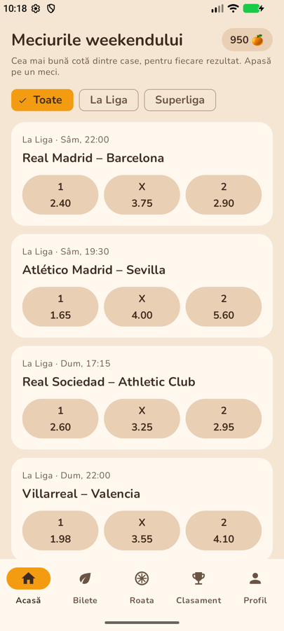
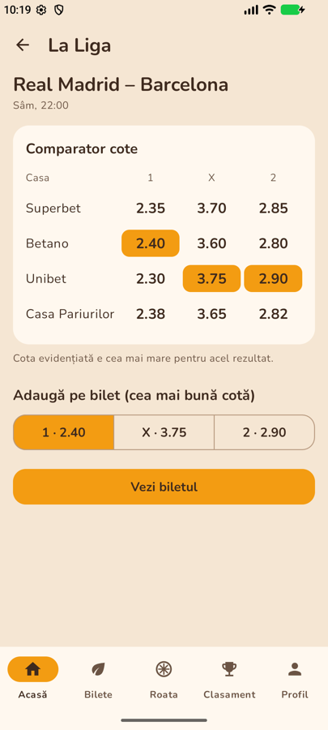
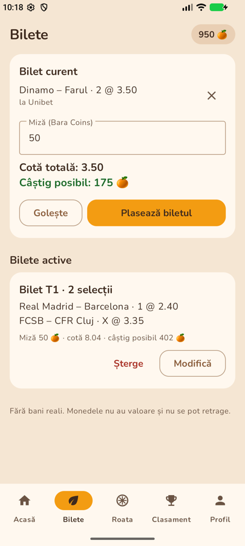
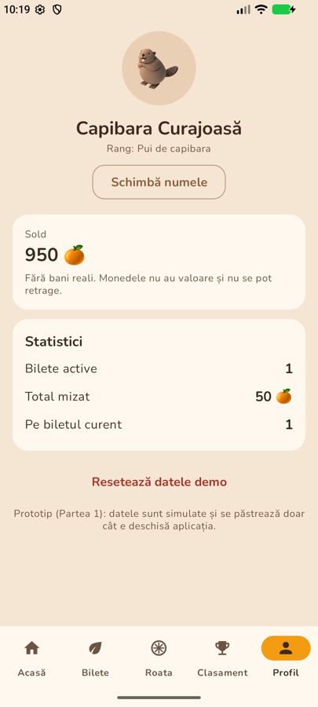

# Sporty-Bara — Documentation technique (Partie 1)

**Auteurs :** SOL · Ludoșan Erin-Andreea  **Version :** 0.1.0 (prototype minimal fonctionnel)  **Date :** novembre 2026

## 1. But de l'application
**Domaine :** culture & loisirs / sport. Sporty-Bara est une application Android de **suivi de paris sportifs sans argent réel**.
- Elle **compare les cotes** de plusieurs bookmakers pour un même match et met en évidence la meilleure.
- L'utilisateur compose des **tickets** avec une monnaie virtuelle (*Bara Coins* 🍊). Ces pièces ne s'achètent pas et ne se retirent pas.
- Thème « capybara » : la mascotte Bara, les ligues privées appelées « bălți » (mares), des rangs de capybara.

Plus tard, l'application calculera **sa propre cote** (modèles Poisson/Elo, déjà commencés côté serveur en Python) et un assistant IA expliquera pourquoi une cote est trop basse ou trop haute. Dans la Partie 1, les données sont **simulées dans le code**.

## 2. Choix technologiques
| Domaine | Choix | Pourquoi |
|---|---|---|
| Plateforme | Android natif, **Java 11**, minSdk 26, targetSdk 36 | langage vu au cours, accès direct au NFC (Partie 2) |
| Interface | **Vues XML + Material Components 3** | composants prêts (cartes, chips, dialogues, Snackbar), thème clair/sombre |
| Navigation | 1 `Activity` + **Fragments** + `BottomNavigationView` + back stack | simple, sans dépendance supplémentaire |
| Listes | `RecyclerView` (matchs) | recyclage des vues pour les longues listes |
| Données (P1) | `FakeRepository` en mémoire + motif **Observer** | écrans indépendants, synchronisés automatiquement |
| Design | palette capybara (crème / brun / orange yuzu), police **Nunito** | contraste AA, lisible, identité visuelle (`docs/DESIGN.md`) |
| Tests | **JUnit 4** sur la logique métier | règles de solde et de mise vérifiées sans émulateur |
| Plus tard | Firebase (Auth, Firestore, Cloud Functions Python), The Odds API | `FakeRepository` sera remplacé sans changer les écrans |

## 3. Structure du projet
```
app/src/main/java/ro/sportybara/app/
├── MainActivity.java          navigation : barre du bas (5 onglets) + écran Match empilé
├── data/                      modèle + données simulées (sans Android → testable)
│   ├── Match, BookmakerOdds   match, cotes 1X2 par bookmaker, best(pick)
│   ├── Pick                   1 / X / 2
│   ├── Selection, Ticket      sélection (cote figée), ticket (cote totale, gain possible)
│   └── FakeRepository         singleton : matchs, ticket en cours, tickets placés, solde, profil
└── ui/                        un Fragment par écran
    ├── HomeFragment           écran 1 – liste des matchs + filtre par ligue
    ├── MatchFragment          écran 2 – comparateur de cotes + ajout au ticket
    ├── TicketsFragment        écran 3 – ticket en cours, tickets placés (modifier / supprimer)
    ├── ProfileFragment        écran 4 – nom, solde, statistiques, réinitialisation
    └── PlaceholderFragment    Roue et Classement (Partie 2)
app/src/main/res/layout/       fragment_*.xml, item_*.xml, dialog_*.xml
app/src/main/res/values/       colors, themes, styles, strings (interface en roumain)
app/src/test/.../FakeRepositoryTest.java   10 tests unitaires
functions/                     backend Python (cotes, modèle, Scout) – travail de l'équipe, Partie 2
docs/                          PLAN, DESIGN, API (contrat de données), cette documentation
```
Le modèle suit les champs de `docs/API.md` (`matches`, `tickets`, `bestOdds`, `potentialWin = floor(mise × cote)`). Le passage à Firestore ne changera donc que la classe repository.

## 4. Navigation (≥ 3 écrans reliés)
`Accueil` → (clic sur un match) → `Match` → « Voir le ticket » / Snackbar → `Billets`. Le bouton Retour revient à la liste. La barre du bas relie **Accueil · Billets · Roue · Classement · Profil**. Toucher à nouveau l'onglet actif ramène à la racine de l'onglet.

## 5. Fonctionnalités de base (ajout / modification / suppression)
| Opération | Où | Règle |
|---|---|---|
| **Ajout** sélection | Match : boutons 1 / X / 2 | meilleure cote du moment, 1 seule sélection par match, max 10 |
| **Ajout** ticket | Billets : « Placer le ticket » | mise ≥ 1 et ≤ solde ; la mise est débitée |
| **Modification** ticket | Billets : « Modifier » (dialogue) | nouvelle mise (solde ajusté de la différence), retrait de sélections |
| **Modification** profil | Profil : « Changer le nom » | 1–30 caractères |
| **Suppression** | sélection (✕), ticket (avec confirmation), réinitialisation démo | la mise revient dans le solde ; un ticket sans sélection est supprimé |

Les erreurs (solde insuffisant, mise vide) s'affichent dans le champ, sans fermer le dialogue. Tous les écrans écoutent le repository : le solde et les tickets se mettent à jour partout.

## 6. Lancer et tester
```bash
./gradlew assembleDebug            # APK : app/build/outputs/apk/debug/app-debug.apk
./gradlew testDebugUnitTest        # 10 tests : meilleure cote, placement, modification, suppression, validations
```
Vérifié sur émulateur (Medium Phone, Android 17) : parcours complet sans plantage. Les captures d'écran se trouvent dans `docs/capturi/`.

---
### Annexe — captures d'écran
| Accueil | Match | Billets | Profil |
|---|---|---|---|
|  |  |  |  |
